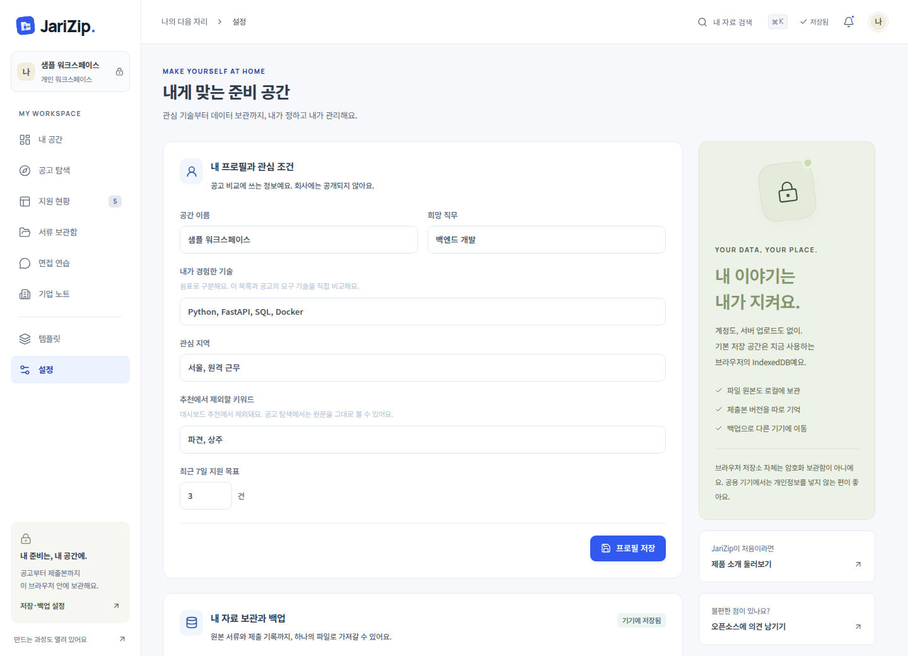

# JariZip · 자리집

**어느 회사에 어떤 이력서로 지원했는지 헷갈릴 때. 채용공고, 제출본, 지원 단계, 면접 준비를 내 PC에 기록하는 무료 오픈소스 앱.**

<p align="center"></p>

<p align="center"><a href="docs/preview/dashboard.png">내 공간</a> · <a href="docs/preview/applications.png">지원 현황</a> · <a href="docs/preview/documents.png">서류 보관함</a> · <a href="docs/preview/interview.png">면접 연습</a> · <a href="docs/preview/">전체 화면 보기</a></p>

> 위 이미지는 실제 JariZip 인터페이스 스크린샷입니다. 채용공고 자동 조회에는 본인이 발급받은 API 키가 필요하지만, 공고 직접 추가·서류 보관·지원 기록은 키 없이 사용할 수 있습니다.

## 1분 만에 시작하기 (API 키 불필요)

1. **[Windows 포터블 EXE 다운로드 (v0.1.0 베타)](https://github.com/Blue-B/JariZip/releases/tag/v0.1.0)** · 설치 프로그램이 아닌 실행 파일입니다.
2. 앱 첫 실행에서 **공고 직접 추가**를 선택합니다. API 키는 없어도 됩니다.
3. 지원하려는 공고의 회사·직무·설명을 저장하고 **지원 준비**로 옮깁니다.
4. 서류 보관함에 이력서를 등록하고 지원 당시 제출한 버전을 기록합니다.

**자동 공고 검색은 선택 기능**입니다. 고용24 등 공식 출처에서 본인에게 발급된 API 자격 증명이 있어야 사용할 수 있습니다. 공고를 직접 추가해도 지원 기록·서류 버전·면접 연습·백업을 사용할 수 있습니다. 기업으로 지원서를 자동 제출하지는 않습니다.

> **Windows 보안 안내:** v0.1.0 실행 파일은 코드 서명되지 않아 SmartScreen 경고가 표시될 수 있습니다. 출처가 GitHub의 이 저장소인지 확인하세요. Windows에서 실제 사용 흐름은 별도 테스터 검증 중이며, 다운로드 횟수를 사용자 수로 간주하지 않습니다. **아래 출처 표는 최신 소스 기준이며, 9월에 배포한 EXE에 모두 포함됐다는 뜻은 아닙니다.** 배포된 실행 파일은 [v0.1.0 Release 노트](https://github.com/Blue-B/JariZip/releases/tag/v0.1.0)를 확인하세요.

**사용자 피드백 모집:** 실제 취업 준비 중이라면 [10분 체험 안내](docs/TESTER_GUIDE.md)를 확인하고 [개선 의견 남기기](https://github.com/Blue-B/JariZip/issues/new/choose)를 이용해주세요. 계정이나 이력서 원본·지원 내역 등 개인정보는 올리지 마세요.

개발자용 실행 방법과 공식 API 연결 안내는 아래에 별도로 정리했습니다.

| 공고 연결 | 서류 보관 | 지원 기록 |
| --- | --- | --- |
|  |  |  |

## 지원하는 채용 출처

| 출처 | 자동 검색 | 필요한 것 |
| --- | --- | --- |
| **고용24** | 지원 | 본인이 발급받은 `WORK24_AUTH_KEY` |
| **사람인** | 지원 | 본인이 발급받은 `SARAMIN_ACCESS_KEY` |
| **조블** | 지원 (목록 검색) | 본인이 발급받은 `JOOBLE_API_KEY` |
| **원티드** | 지원 | 본인이 발급받은 `WANTED_CLIENT_ID`·`WANTED_CLIENT_SECRET` (두 값 모두) |
| **잡알리오** | 지원 (목록 검색) | 공공데이터포털 일반 인증키 `JOBALIO_SERVICE_KEY` |
| 점핏 | 자동조회 미지원 | 원문 링크를 직접 열어 기록 |
| 직행 | 자동조회 미지원 | 원문 링크를 직접 열어 기록 |
| 잡코리아 | 자동조회 미지원 | 기관·서버 IP 승인 기반이라 원문 링크를 직접 열어 기록 |

**점핏·직행·잡코리아는 API 키 없이 자동 조회되는 출처가 아닙니다.** 점핏·직행은 JariZip에서 사용 권한이 확인된 공식 자동조회 API가 없어 자동 조회와 설정을 제공하지 않습니다. 잡코리아는 공식 API가 있지만 운영 기관·서버 IP 등록과 담당자 승인을 전제로 발급되므로, JariZip은 일반 로컬 사용자용 자동 조회를 연결하지 않습니다. 원문 링크를 직접 열어 공고를 기록해주세요. 공식 API 사용 권한이 확인된 고용24·사람인·조블·원티드·잡알리오만 개인 설정값으로 연결합니다.

공식 안내: [고용24 Open API](https://www.work24.go.kr/cm/e/a/0110/selectOpenApiIntro.do) · [사람인 API](https://oapi.saramin.co.kr/guide/info) · [조블 API](https://kr.jooble.org/api/about) · [원티드 OpenAPI](https://openapi.wanted.jobs/apply/) · [잡알리오 데이터셋](https://www.data.go.kr/data/15125273/openapi.do)

## 할 수 있는 일

- 실제 채용공고 검색·보관 또는 공고 직접 추가
- 지원 단계 관리
- 이력서·자기소개서·경력기술서·포트폴리오 보관
- 서류 수정 시 **새 버전으로 보존**
- 지원 당시 사용한 공고와 제출 서류 버전 고정
- 면접 질문·답변·연습 녹음 기록
- 기업별 메모
- 전체 자료 JSON 백업·복원

기업에 지원서를 자동 제출하거나 합격 확률을 계산하지 않습니다.

## 내 자료는 어디에 저장되나요?

서류, 공고, 지원 기록, 메모와 녹음은 **현재 PC의 JariZip 로컬 저장소**에 보관됩니다. 계정이나 중앙 사용자 DB는 없습니다.

- 브라우저/앱 데이터를 지우면 자료가 없어질 수 있으므로 정기적으로 백업하세요.
- 전체 백업은 40MB까지 지원합니다.
- 백업 파일에는 서류 원본과 녹음이 포함될 수 있으며 암호화 파일은 아닙니다.
- 여러 창에서 동시에 수정하면 오래된 창이 최신 자료를 덮어쓰지 않도록 충돌을 감지합니다.

## 개발자용 실행

데스크톱 앱 없이 기존 로컬 웹 모드로도 사용할 수 있습니다.

```bash
npm ci
npm run build
npm start
```

브라우저에서 `http://localhost:4178/`을 엽니다. 이 모드에서는 **내 설정 → 공고 연결**의 출처 목록에서 고용24·사람인·조블·원티드·잡알리오 설정값을 붙여넣어 설정하고 바로 조회를 확인할 수 있어요. 키를 처음 설정하면 **키 설정**, 이미 설정되어 있으면 **키 변경**, 필요 없으면 **키 삭제**를 사용합니다. 저장한 값은 서버가 필요한 경우 프로젝트의 `.env.local`에 보관하며, 파일을 직접 고치지 않아도 재시작 없이 즉시 반영됩니다. 값은 화면·로그·URL로 다시 전달되지 않고, 설정 여부만 참/거짓으로 표시됩니다.

`.env.local`을 직접 관리하고 싶다면 다음 변수를 채워 넣어도 됩니다.

```env
WORK24_AUTH_KEY=
SARAMIN_ACCESS_KEY=
JOOBLE_API_KEY=
WANTED_CLIENT_ID=
WANTED_CLIENT_SECRET=
JOBALIO_SERVICE_KEY=
```

데스크톱 개발/패키징:

```bash
npm run desktop          # Electron 앱 실행
npm run desktop:smoke    # 데스크톱 통합 검사
npm run package:win             # Windows portable EXE (권장)
npm run package:win:installer   # Windows 설치형 EXE (Windows/Wine 빌드 환경 필요)
npm run package:linux           # Linux 검증용 패키지
```

현재 기술 구성은 React + TypeScript + Vite, Node.js `node:http`, Electron, IndexedDB, PDF.js, Mammoth, Zod입니다. Redis·Kafka·PostgreSQL 같은 별도 서버 인프라는 로컬 앱에 필요하지 않아 사용하지 않습니다.

자세한 데스크톱 구조와 보안 경계는 [docs/desktop-app.md](docs/desktop-app.md)를 참고하세요.

## 라이선스

MIT. 소스코드 라이선스는 외부 채용공고의 수집·복제·재배포 권한을 의미하지 않습니다.
