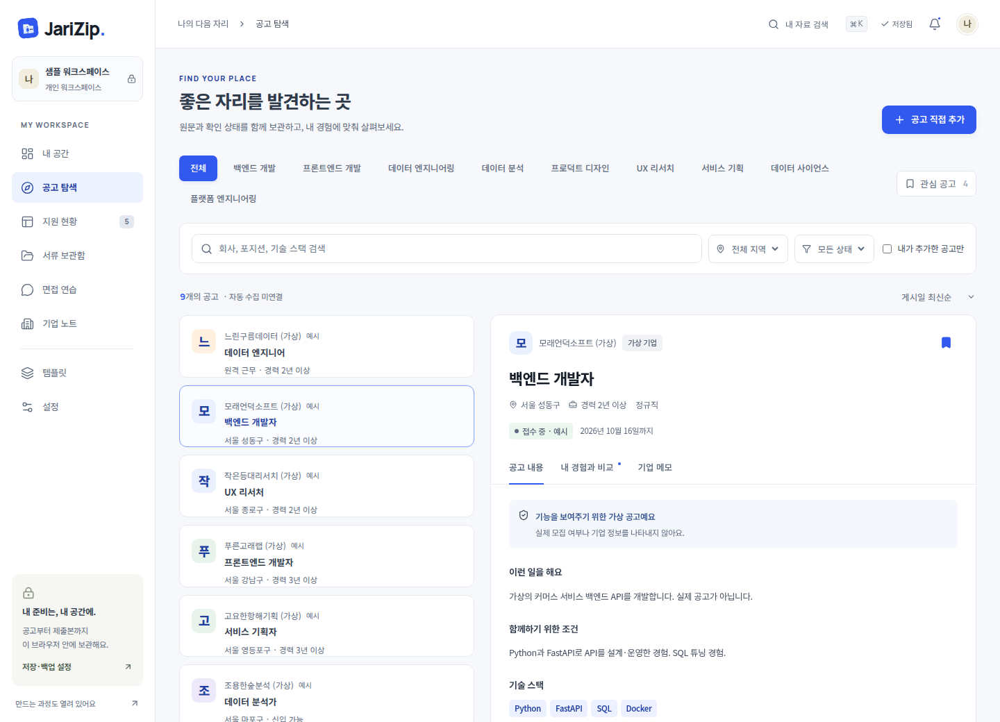
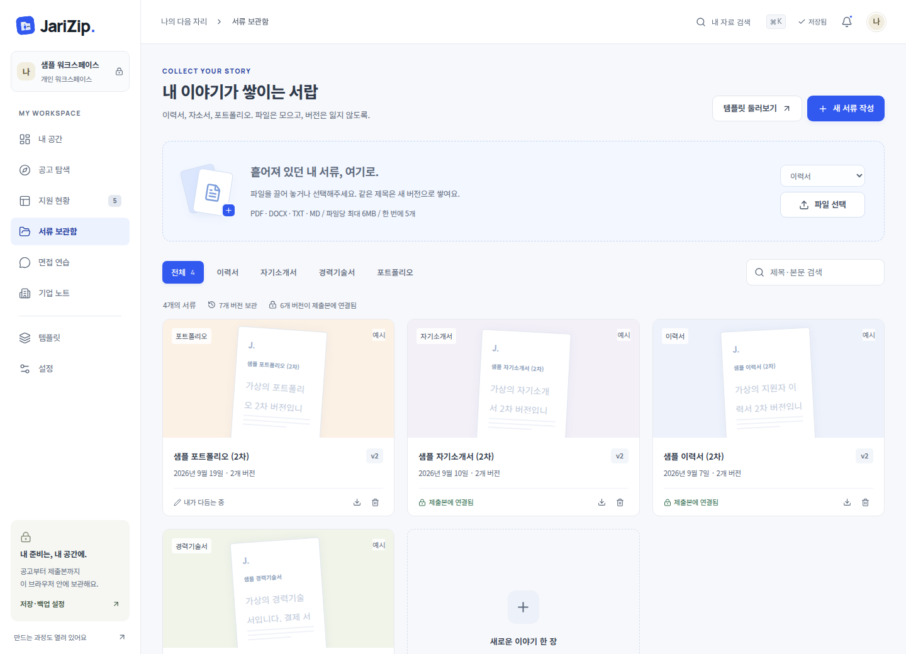
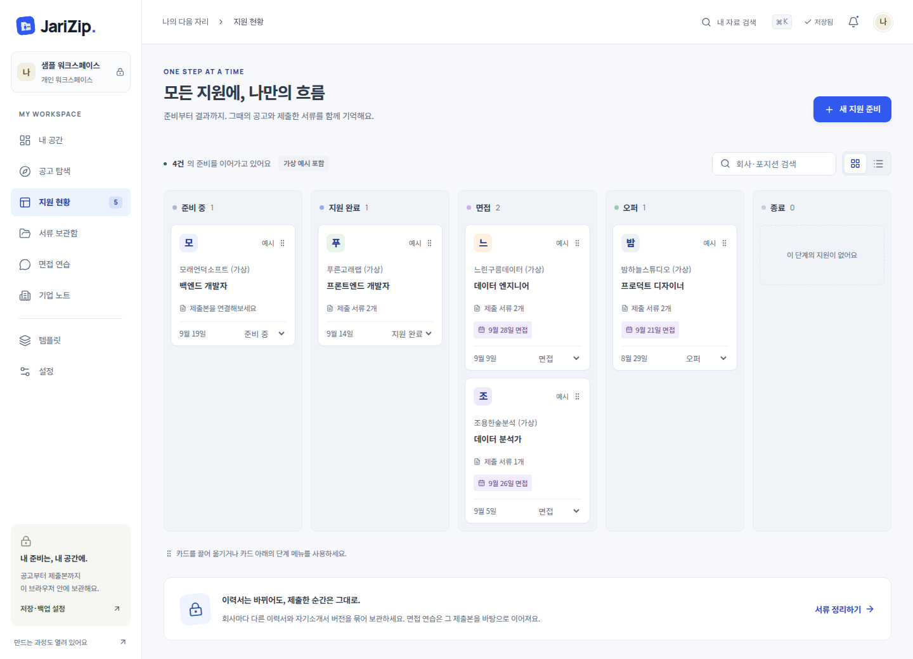

# JariZip 처음 사용하기

Windows 데스크톱 앱 기준 안내입니다.

## 1. 앱 실행

GitHub Release에 게시되는 Windows 설치 파일 또는 포터블 EXE를 실행합니다. 앱 자체에 Node.js와 로컬 조회 서버가 포함되므로 별도로 Node.js를 설치할 필요가 없습니다.

> **[v0.1.0 Beta Windows 포터블 EXE 다운로드](https://github.com/Blue-B/JariZip/releases/tag/v0.1.0)** (2026년 9월 26일 공개). 코드 서명이 없어 SmartScreen 경고가 표시될 수 있습니다.

## 2. API 키 없이 먼저 써보기

처음 실행하면 공고 연결 마법사가 열립니다. **공고 직접 추가하기**를 선택해 자동 검색 연결을 건너뛸 수 있습니다.

1. **공고 직접 추가하기**를 눌러 회사 이름, 직무명, 공고 설명을 입력합니다.
2. 보관한 공고에서 **지원 준비**를 눌러 지원 기록을 만듭니다.
3. **서류 보관함**에서 이력서/자기소개서를 보관하고 제출한 버전을 연결합니다.
4. 지원 현황에서 단계를 기록하고 면접 질문을 연습합니다.

## 3. 자동 채용공고 검색 (선택)

고용24·사람인·조블·원티드·잡알리오 자동 검색을 사용하려면 본인에게 발급/승인된 공식 API 자격 증명이 필요합니다. 설정에서 연결 안내를 보고 값을 입력한 뒤 조회 여부를 확인합니다. 원티드는 client ID와 client secret, 잡알리오는 공공데이터포털 인증키를 사용합니다.

데스크톱 앱은 자격 증명을 운영체제 보안 저장소에 암호화해 보관하며, 브라우저 저장소나 JariZip 백업 파일에는 넣지 않습니다.

**참고:** 현재 공개된 v0.1.0 EXE와 저장소의 최신 소스는 버전이 다를 수 있습니다. Release 노트에 적힌 지원 출처가 해당 배포물의 기준입니다.

## 4. 공고 찾기

채용 탐색에서 키워드·지역·직무·경력 조건으로 찾습니다. 공식 API 결과라도 지원 전에는 원문에서 모집 상태와 마감 시간을 다시 확인하세요.

## 5. 서류와 지원 기록 관리

서류를 수정하면 이전 파일을 덮어쓰지 않고 새 버전으로 보관합니다.

지원 기록에는 그 시점의 공고와 실제 제출한 서류 버전을 연결해 남깁니다.

## 6. 백업

설정에서 **전체 백업 내려받기**를 사용합니다.

- 자료는 현재 PC에 저장됩니다.
- 자동 클라우드 동기화는 없습니다.
- 전체 JSON 백업은 40MB까지 지원합니다.
- 백업은 암호화되지 않으므로 다른 사람에게 공유하지 마세요.

## 연결을 바꾸고 싶을 때

**설정 → 공고 연결 → 연결 설정**에서 고용24·사람인·조블·원티드·잡알리오 설정값을 추가하거나 삭제할 수 있습니다. 점핏·직행은 승인된 공식 자동화 API가 없고, 잡코리아 공식 API는 기관·서버 IP 승인 기반이라, 세 출처 모두 원문에서 직접 확인하고 기록합니다.
